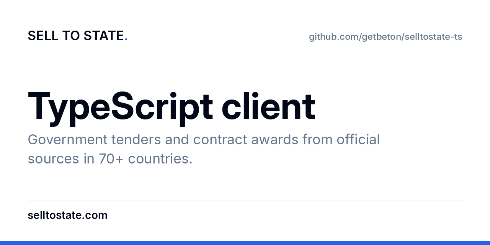

<p align="center">
  <a href="https://www.selltostate.com/?utm_source=github&utm_medium=referral&utm_campaign=sts-public-repos&utm_content=selltostate-ts"></a>
</p>

<h1 align="center">Sell to State TypeScript client</h1>

<p align="center">The official TypeScript and JavaScript client for the Sell to State API: government tenders, contract awards, buyers and suppliers from 70+ countries.</p>

<p align="center">
  <a href="https://www.selltostate.com/api/?utm_source=github&utm_medium=referral&utm_campaign=sts-public-repos&utm_content=selltostate-ts"><b>Website</b></a> ·
  <a href="https://docs.selltostate.com/?utm_source=github&utm_medium=referral&utm_campaign=sts-public-repos&utm_content=selltostate-ts"><b>Docs</b></a> ·
  <a href="https://app.selltostate.com/account/keys?utm_source=github&utm_medium=referral&utm_campaign=sts-public-repos&utm_content=selltostate-ts"><b>API keys</b></a> ·
  <a href="https://www.selltostate.com/pricing/?utm_source=github&utm_medium=referral&utm_campaign=sts-public-repos&utm_content=selltostate-ts"><b>Pricing</b></a> ·
  <a href="mailto:support@selltostate.com"><b>Support</b></a>
</p>

<p align="center">
  <a href="LICENSE"></a>
  <a href="https://www.npmjs.com/package/selltostate"></a>
  <a href="#install"></a>
</p>

<!-- ask-ai:start -->
<p align="center"><sub>Ask AI about this repo</sub></p>
<p align="center">
  <a href="https://claude.ai/new?q=Read%20https%3A%2F%2Fgithub.com%2Fgetbeton%2Fselltostate-ts%20and%20https%3A%2F%2Fdocs.selltostate.com%2Fllms.txt.%20Then%20help%20me%20use%20the%20Sell%20to%20State%20TypeScript%20client%3A%20government%20tenders%20and%20contract%20awards%20from%20official%20sources%20in%2070%2B%20countries.%20First%20ask%20me%20what%20my%20company%20sells%20and%20in%20which%20countries."></a>
  <a href="https://chatgpt.com/?q=Read%20https%3A%2F%2Fgithub.com%2Fgetbeton%2Fselltostate-ts%20and%20https%3A%2F%2Fdocs.selltostate.com%2Fllms.txt.%20Then%20help%20me%20use%20the%20Sell%20to%20State%20TypeScript%20client%3A%20government%20tenders%20and%20contract%20awards%20from%20official%20sources%20in%2070%2B%20countries.%20First%20ask%20me%20what%20my%20company%20sells%20and%20in%20which%20countries."></a>
  <a href="https://www.google.com/search?udm=50&q=Read%20https%3A%2F%2Fgithub.com%2Fgetbeton%2Fselltostate-ts%20and%20https%3A%2F%2Fdocs.selltostate.com%2Fllms.txt.%20Then%20help%20me%20use%20the%20Sell%20to%20State%20TypeScript%20client%3A%20government%20tenders%20and%20contract%20awards%20from%20official%20sources%20in%2070%2B%20countries.%20First%20ask%20me%20what%20my%20company%20sells%20and%20in%20which%20countries."></a>
  <a href="https://grok.com/?q=Read%20https%3A%2F%2Fgithub.com%2Fgetbeton%2Fselltostate-ts%20and%20https%3A%2F%2Fdocs.selltostate.com%2Fllms.txt.%20Then%20help%20me%20use%20the%20Sell%20to%20State%20TypeScript%20client%3A%20government%20tenders%20and%20contract%20awards%20from%20official%20sources%20in%2070%2B%20countries.%20First%20ask%20me%20what%20my%20company%20sells%20and%20in%20which%20countries."></a>
  <a href="https://www.perplexity.ai/search?q=Read%20https%3A%2F%2Fgithub.com%2Fgetbeton%2Fselltostate-ts%20and%20https%3A%2F%2Fdocs.selltostate.com%2Fllms.txt.%20Then%20help%20me%20use%20the%20Sell%20to%20State%20TypeScript%20client%3A%20government%20tenders%20and%20contract%20awards%20from%20official%20sources%20in%2070%2B%20countries.%20First%20ask%20me%20what%20my%20company%20sells%20and%20in%20which%20countries."></a>
  <a href="https://github.com/copilot?prompt=Read%20https%3A%2F%2Fgithub.com%2Fgetbeton%2Fselltostate-ts%20and%20https%3A%2F%2Fdocs.selltostate.com%2Fllms.txt.%20Then%20help%20me%20use%20the%20Sell%20to%20State%20TypeScript%20client%3A%20government%20tenders%20and%20contract%20awards%20from%20official%20sources%20in%2070%2B%20countries.%20First%20ask%20me%20what%20my%20company%20sells%20and%20in%20which%20countries."></a>
</p>
<!-- ask-ai:end -->

---

[Sell to State](https://www.selltostate.com/?utm_source=github&utm_medium=referral&utm_campaign=sts-public-repos&utm_content=selltostate-ts) collects government tenders and contract awards from official procurement portals in 70+ countries. It puts them in one schema: buyer, supplier, amount, dates and sector. Every record links to the official notice. [Countries and data depth](https://www.selltostate.com/countries/?utm_source=github&utm_medium=referral&utm_campaign=sts-public-repos&utm_content=selltostate-ts).

## Install

```bash
npm install selltostate
```

The package has compiled JavaScript and type declarations in `dist/`. A dependency on `github:getbeton/selltostate-ts` also works: npm builds `dist/` in the `prepare` script.

## Quick start

```ts
import { SellToState } from "selltostate";

const sts = new SellToState({ apiKey: process.env.STS_API_KEY });

console.log(await sts.whoami());
const tenders = await sts.search({ scope: "tenders", q: "payroll software", country: "united-kingdom" });
```

`search` returns tenders and awards. Use `scope` (`tenders`, `buyers`, `suppliers` or `sectors`), `q`, `country` (a slug such as `united-kingdom`), `sector`, `status`, `year_min`, `year_max`, `amount_min`, `page` and `per_page` (50 or less).

## Methods

One method for each operation in the [OpenAPI spec](https://github.com/getbeton/selltostate-api-reference). Each method takes one map of arguments: query parameters, path parameters and `body`.

<details>
<summary>All 29 methods</summary>

| Method | HTTP | What it does |
|---|---|---|
| `searchAwards` | `GET /api/v1/awards` | Search awarded government tenders |
| `exportAwardsCsv` | `GET /api/v1/awards.csv` | Export awarded tenders as CSV |
| `getPrice` | `GET /api/v1/price` | Live subscription price |
| `payAutonomously` | `POST /api/v1/pay` | Activate a subscription autonomously (agent payment) |
| `registerClient` | `POST /api/oidc/register` | Dynamic Client Registration (RFC 7591) |
| `mcp` | `POST /api/mcp` | MCP-over-HTTP (JSON-RPC 2.0) |
| `protectedResourceMetadata` | `GET /.well-known/oauth-protected-resource` | Protected Resource Metadata (RFC 9728) |
| `authorizationServerMetadata` | `GET /.well-known/oauth-authorization-server` | Authorization Server Metadata (RFC 8414) |
| `whoami` | `GET /api/v1/whoami` | Self-introspection: auth, entitlement & scopes |
| `search` | `GET /api/v1/search` | Faceted full-text search (one collection) |
| `listBuyers` | `GET /api/v1/buyers` | Top buyers by spend |
| `getBuyer` | `GET /api/v1/buyers/{slug}` | Buyer (agency) detail |
| `listSuppliers` | `GET /api/v1/suppliers` | Top suppliers by awarded total |
| `getSupplier` | `GET /api/v1/suppliers/{slug}` | Supplier detail |
| `listSectors` | `GET /api/v1/sectors` | Sector taxonomy |
| `getSector` | `GET /api/v1/sectors/{slug}` | Sector detail |
| `getTender` | `GET /api/v1/tenders/{id}` | Single award (tender) detail |
| `getLists` | `GET /api/v1/lists` | List saved award lists |
| `createList` | `POST /api/v1/lists` | Create a saved list |
| `getList` | `GET /api/v1/lists/{id}` | Get a saved list + items |
| `renameList` | `PATCH /api/v1/lists/{id}` | Rename a saved list |
| `deleteList` | `DELETE /api/v1/lists/{id}` | Delete a saved list |
| `addToList` | `POST /api/v1/lists/{id}/items` | Add a tender to a list |
| `removeFromList` | `DELETE /api/v1/lists/{id}/items` | Remove a tender from a list |
| `getSavedSearches` | `GET /api/v1/saved-searches` | List saved searches |
| `saveSearch` | `POST /api/v1/saved-searches` | Save a search |
| `getSavedSearch` | `GET /api/v1/saved-searches/{id}` | Get a saved search |
| `renameSavedSearch` | `PATCH /api/v1/saved-searches/{id}` | Rename a saved search |
| `deleteSavedSearch` | `DELETE /api/v1/saved-searches/{id}` | Delete a saved search |

</details>

## Authentication

1. Create an account with an active plan at [app.selltostate.com](https://app.selltostate.com/?utm_source=github&utm_medium=referral&utm_campaign=sts-public-repos&utm_content=selltostate-ts).
2. Create an API key at [app.selltostate.com/account/keys](https://app.selltostate.com/account/keys?utm_source=github&utm_medium=referral&utm_campaign=sts-public-repos&utm_content=selltostate-ts). A key starts with `sts_`.
3. Set the key in the environment:

```bash
export STS_API_KEY=sts_...
```

The client sends the key in the `x-api-key` header. Do not send the key as a bearer token.

An agent without an account can register itself and pay on its own. It then sends `Authorization: Bearer client:<id>`. The [API guide](https://github.com/getbeton/selltostate-api-reference/blob/main/api-guide.md) has the steps.

| Variable | Required | Default |
|---|---|---|
| `STS_API_KEY` | Yes, or a client ID | |
| `STS_API_URL` | No | `https://app.selltostate.com` |

## Errors

The client does not retry a failed call.

| Status | Meaning | What to do |
|---|---|---|
| 401 | The key is missing or not valid | Set `STS_API_KEY` |
| 402 | No active plan | The error has `payment_link`, `plan` and `machine_payment`. Pay, then call again |
| 429 | Rate limit (300 search calls per minute per key) | Wait, then call again |

Known issue: `amount_max` is in the spec, but the awards endpoint can ignore it. The client sends it.

This is the only JavaScript SDK. The [Node.js](https://github.com/getbeton/selltostate-node) and [Next.js](https://github.com/getbeton/selltostate-next) examples import it.

## Related

| Repo | What |
|---|---|
| [selltostate-skills](https://github.com/getbeton/selltostate-skills) | Agents: Agent skills and MCP plugin: Claude Code, Codex, Cursor, Gemini CLI |
| [selltostate-mcp](https://github.com/getbeton/selltostate-mcp) | Agents: Local (stdio) MCP server with an API key |
| [selltostate-api-reference](https://github.com/getbeton/selltostate-api-reference) | API: OpenAPI spec, API guide, llms.txt |
| [selltostate-cli](https://github.com/getbeton/selltostate-cli) | API: Command-line client |
| [selltostate-py](https://github.com/getbeton/selltostate-py) | API: Python client |
| [selltostate-java](https://github.com/getbeton/selltostate-java) | API: Java client |
| [selltostate-kotlin](https://github.com/getbeton/selltostate-kotlin) | API: Kotlin client |
| [selltostate-rust](https://github.com/getbeton/selltostate-rust) | API: Rust client |
| [selltostate-ror](https://github.com/getbeton/selltostate-ror) | API: Ruby client |
| [selltostate-node](https://github.com/getbeton/selltostate-node) | Examples: Node.js example |
| [selltostate-next](https://github.com/getbeton/selltostate-next) | Examples: Next.js example (server route) |
| [selltostate-js](https://github.com/getbeton/selltostate-js) | Examples: Browser example (URL shape only) |
| [n8n-nodes-selltostate](https://github.com/getbeton/n8n-nodes-selltostate) | Automation: n8n community nodes and trigger |
| [zapier-selltostate](https://github.com/getbeton/zapier-selltostate) | Automation: Zapier integration |
| [how-governments-buy-ai](https://github.com/getbeton/how-governments-buy-ai) | Research: Notebook: rerun the study "How governments buy AI" |

## Support

- Bugs in this repo: [open an issue](https://github.com/getbeton/selltostate-ts/issues).
- Account, plans and data: support@selltostate.com.
- Security problems: see [SECURITY.md](SECURITY.md).
- News: [x.com/selltostate](https://x.com/selltostate).

## License

[MIT](LICENSE). The data is subject to the [Sell to State terms](https://www.selltostate.com/terms/) and to the terms of each official source.
